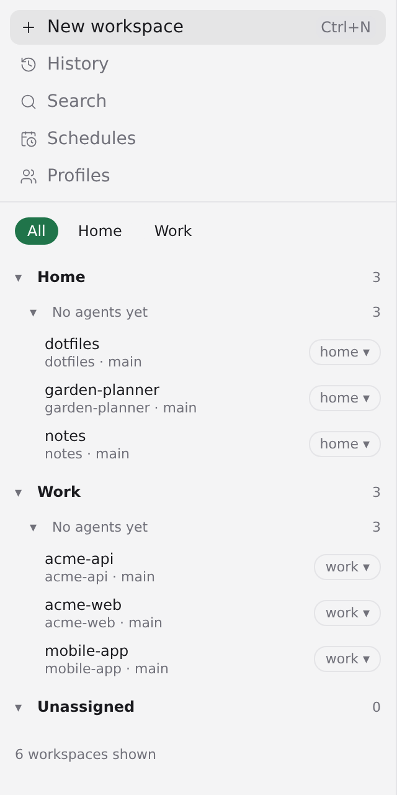
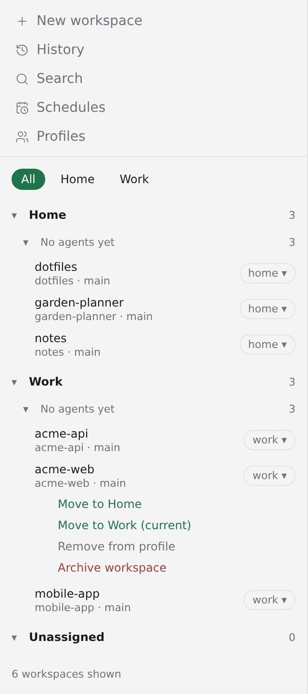
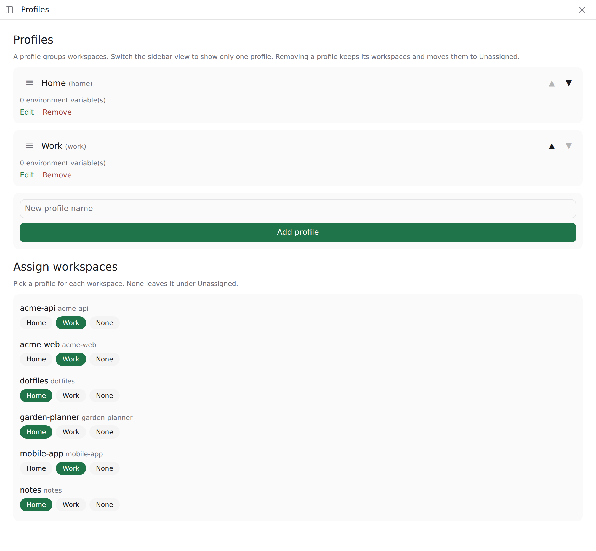

# paseo-multi-profile

A [Paseo](https://paseo.sh) plugin that separates workspaces into profiles (for example **home** and **work**) on a single daemon. Providers and models are shared; workspaces are not.

- **Sidebar view** "Workspaces by profile": group by profile, switch between one profile or all. The choice is per device.
- **New workspace field**: pick the profile at creation; it defaults to the one your device is viewing.
- **Move workspaces** between profiles from the sidebar view.
- **Optional env separation**: per-profile environment variables (e.g. a separate API key) injected into agents opened in that profile's workspaces.

Profiles are a label (`profile:<id>`) on each workspace. This is organisation, not access control.

## Screenshots

Sample data only.

| Sidebar tree | Workspace menu | Profiles screen |
| --- | --- | --- |
|  |  |  |

## Install

```bash
paseo plugin install github:bearyjd/paseo-multi-profile
```

Then enable the view in **Settings > Sidebar > Sidebar view**.

## Develop

```bash
npm install
npm run typecheck
paseo plugin install "$(pwd)"   # once
paseo plugin reload paseo-multi-profile
```

Layout: `shared/` (settings schemas), `server/` (hooks), `client/` + `index.client.tsx` (UI).
